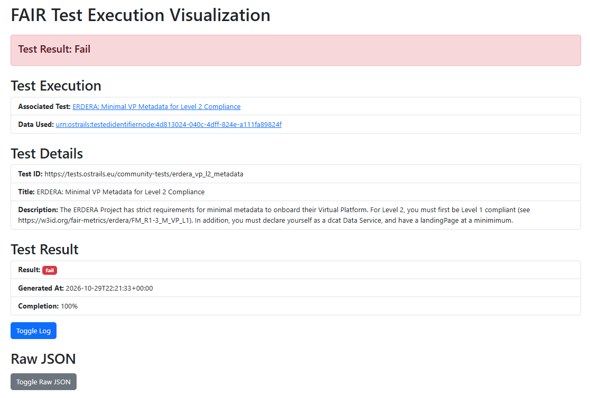
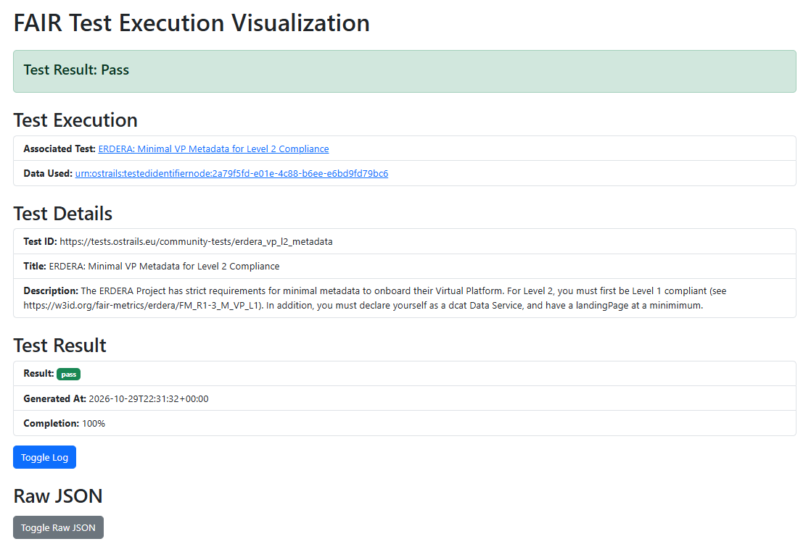

Validate your L2 implementation
------------

If you have set up a Beacon v2 endpoint, you can check that the metadata record for your data service is correct with the ERDERA Level 2 test hosted in the FAIR Champion tool. It works the same way as the Level 1 test.

Please note that this test assesses the metadata in your FDP that describes your Beacon v2 endpoint, not the Beacon v2 endpoint itself.

The Level 2 test checks that your metadata:

* is Level 1 compliant (see the `Level 1 validation <validator_l1.rst>`_);
* declares your resource as a dcat:DataService;
* provides at least a dcat:landingPage.

Steps to use the Level 2 validation test:

1. Find the `ERDERA test for Level 2 in FAIR Champion <https://tools.ostrails.eu/champion/tests/?keyword=ERDERA%3A+Minimal+VP+Metadata+for+Level+2+Compliance>`_ and click on the blue button with that title.
2. In the test's interface, enter the resource identifier/GUID (record URL) of the data service record in your FDP and run the test. More detailed information can be found in the description of the test, and by clicking the "Additional details" entry.
3. Read the result at the top of the response (pass/fail). In case of fail, the log explains which requirements are not met, as shown in the figure below.

4. Based on the test feedback, you can either fix the information yourself or contact the onboarding team for support. Once all fixes are made, run the test again to confirm it passes.

Alternatively, you can also run the test from the command line:

.. code-block:: bash

   curl -X POST -H "Content-Type: application/json" -H "Accept: application/json" \
     -d '{"resource_identifier": "YOUR_URL_HERE"}' \
     https://tests.ostrails.eu/community-tests/assess/test/erdera_vp_l2_metadata
